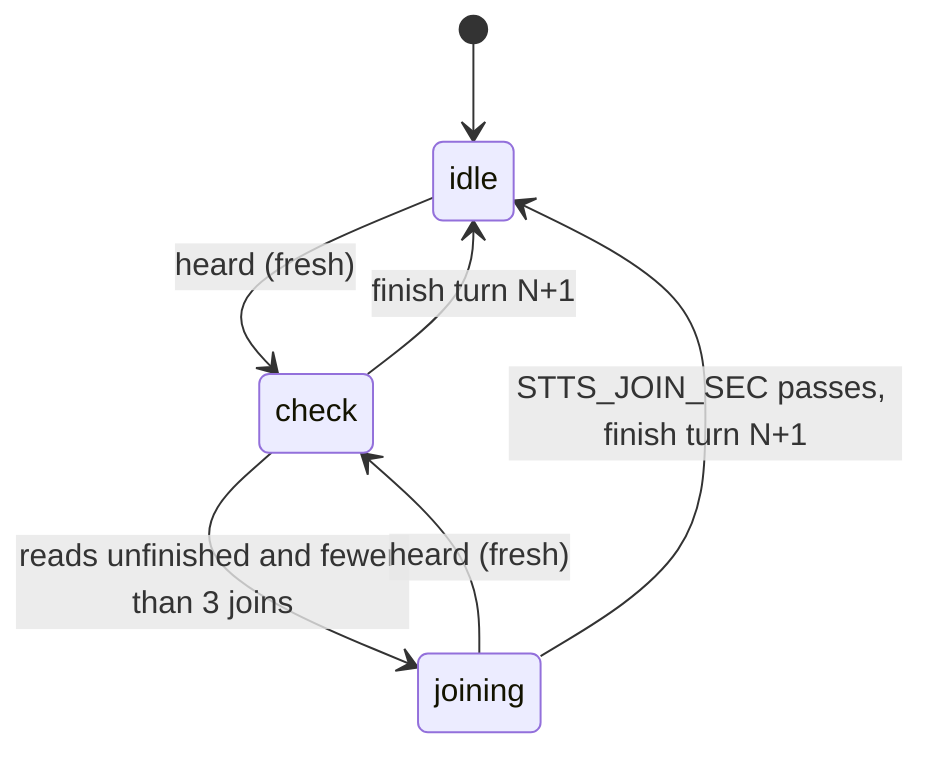

# Turns

## What it does

Turns what Mark says into numbered turns. Each reply starts with `[turn N, heard HH:MM:SS to HH:MM:SS]`, or `[turn N, typed ...]` when he typed it on the keyboard, so the agent knows how the turn came in, N always rises, repeats and stale speech are dropped, a sentence cut mid-thought is joined with what follows, and an agent cannot listen again before it has answered the last turn.

## Why it exists

Agents used to answer the same words twice, answer old speech, or ask him to finish a sentence the window had cut. Numbering and gating the turns makes the conversation strictly listen, answer, listen.

## How it works

`src/turns.ts` is an XState machine the daemon runs.

- **Dropped:** speech that ended before the last turn ended (stale), or the same text ending within 1 second of the last (duplicate).
- **Join:** if the speech reads unfinished (spec 001), the machine waits `STTS_JOIN_SEC` seconds (default 4) for more, up to 3 joins, then returns all of it as one turn. The wait never ends while he is talking again (the page's `talking`, sent with every interim word): it starts over until his next words arrive. One thought was returned as three turns when he paused about 4 s after "not just" and the 3 s wait ran out as he resumed (log 2026-11-13 00:10 UTC).
- **Held words settle first.** Words held while no listen was open are not returned the instant a listen opens when they ended under 1.5 s ago or he is talking: they wait 1.5 s (the full join wait when they read unfinished) for the rest and join it. Before, a listen that opened mid-sentence returned the first half at once and the rest came as a second turn.
- Parity (spec 076): the callbot holds a turn while Recall partials or speech events show the room talking (`isQuiet`), has no window for live words and no listen-open race (its buffer flushes on quiet only); its join wait is the same 4 s.
- **Ack gate:** after a turn is returned it is unanswered. A tts call answers it. An stt call while it is unanswered gets status 409 with `turn N is unanswered. Answer it now with tts (listen=true), or, if it needs no spoken answer, call stt with ack=N.` An stt with `ack=N` passes and marks it answered.
- No-speech, listen-continues and background-result replies are not turns and change nothing.
- **A listen is for the next new turn, never for permission (Mark 2026-11-08).** An agent that announces an action starts that work in the same turn as the tts call and never waits for a go-ahead; only a wall stops it. Parity: skill `talk-hands-free-with-stts` loop step 2.
- **Typed turns.** A message typed into the voice window is a turn exactly like heard speech: same prefix, ids, dedupe, join and ack gate. Typed with no listen open, it is held and returned by the next stt or tts listen, added to any words already held, never replacing them. A barge turn starts with any held words, so a sentence begun while no listen was open arrives whole (Mark 2026-10-16).
- **Barge-in turns.** A turn that cut the agent's speech off is returned by the cut-off tts call itself, with the barge line after it (spec 003). The barge is typed, or spoken over the agent: the mic runs during speech and any words of his that are not the agent's own echo cut it off, one word included ("hello"; Mark 2026-11-15: "I should always be able to interrupt with just a word"). One or two words are echo when every one is, or nearly is, a word the agent spoke in the last 30 s (digits read as words, a short word one letter off only beside a long matched word), since the text check for 3 or more words cannot judge so few (a 2-word echo cut a question read off, 2026-11-15 09:02 UTC). Fillers and acknowledgements (uh, um, hmm, yeah, okay) cut it off too: anything he says stops it, no exceptions (Mark 2026-11-16: "even the stts should stop for anything spoken no exceptions"). Only the agent's own echo is not his speech. The page logs the mic track's applied `echoCancellation` and `noiseSuppression` on every open (`page mic open: ...`): the browser's echo canceller is the first line, this text check catches what leaks past it through virtual audio devices (SteelSeries Sonar) or loud speakers (spec 005). It is unanswered like any turn. `BARGE_NOTE` in both tool descriptions tells the agent to treat it as an addition or steer and to continue the cut-off task unless it says stop, abort, halt or never mind (house rule 47).
- **Silence never ends a listen while he is speaking (Mark 2026-11-08 22:03).** The page's idle timer can fire with interim words but no final; the daemon ignores that `nospeech` while the talking light is on, so his turn is returned by the same listen instead of being held for the next. Parity: the callbot has no page idle timer.
- If the listen went away while a turn was joining, its words are kept and put in front of the next listen's speech.

## Quality bar

Register B19 (ISO/IEC 25010:2023). Baselines measured 2026-11-26 unless dated.

| Aspect | Metric, baseline and floor | Research and alternative | Gate |
| --- | --- | --- | --- |
| Functional suitability | Rising ids, dedupe, stale drop, joins and the 409 with `ack`: `turns.test.ts` 10/10; floor 0 failing | monotonic ids with idempotent dedupe; alternative: timestamps only (repeats got through) | vitest in `npm run gate` (Trunk pre-push) |
| Performance efficiency and optimisation | `turns.test.ts` 24 ms for 10 cases; turn building adds no network hop | in-memory join in the daemon | vitest timing |
| Compatibility | Heard and typed turns share one header shape `[turn N, ...]` | one header format for every agent CLI | `turns.test.ts` |
| Interaction capability | Stop words (stop, wait, no, pause, enough) always cut in, even over the agent's own word: `bargeVerdict` case | Mark's live reports 2026-11-16 | `turns.test.ts`, `machine.test.ts` |
| Reliability | No turn lost or repeated across reconnects: dedupe and stale-drop cases pass; floor 0 failing | at-least-once delivery plus dedupe | `turns.test.ts` |
| Security | 0 secrets in repo; the daemon and Piper bind 127.0.0.1 only, nothing listens off the machine; floor 0 gitleaks findings | OWASP ASVS V14 config; alternative: LAN-reachable daemon (rejected: no auth needed when local only) | gitleaks in Trunk (`trunk check` in the gate) |
| Maintainability | `npm run maint` 2026-11-26: 0 dependency violations (53 modules), 0 jscpd clones, knip clean; spec has the five sections; floor all three clean | dependency-cruiser, knip, jscpd; markdownlint MD043 for sections | `npm run maint`, `markdownlint-cli2` in `npm run gate` (Trunk pre-push) |
| Flexibility and portability | n/a: one input shape (speech or typed text) | n/a | n/a |
| Safety | n/a: a turn is text handed to the agent; it changes nothing by itself | n/a | n/a |
| Business outcome | n/a: Mark's personal voice tool, no business metric | n/a | n/a |
| Cost | USD 0: Chrome speech recognition and local Piper, no paid API; floor no paid call added | free platform APIs first (rule 1) | n/a: no paid dependency to cap (rule 97) |

## What it reads and writes

Reads `STTS_JOIN_SEC`. Holds turn state in memory only; a daemon restart starts again at turn 1.

## How to run, check and hand over

`test/unit/turns.test.ts` covers rising ids, dedupe and stale drops, joins and the 409 with `ack`. Run `npm test`.

- **Stop words always cut in (2026-11-16).** One or two words over the agent's speech that include stop, wait, no, pause or enough are a barge even when the agent's own sentence held the same word: "Stop." over "say stop whenever you like" was discarded as echo. Test in `bargeVerdict`.
