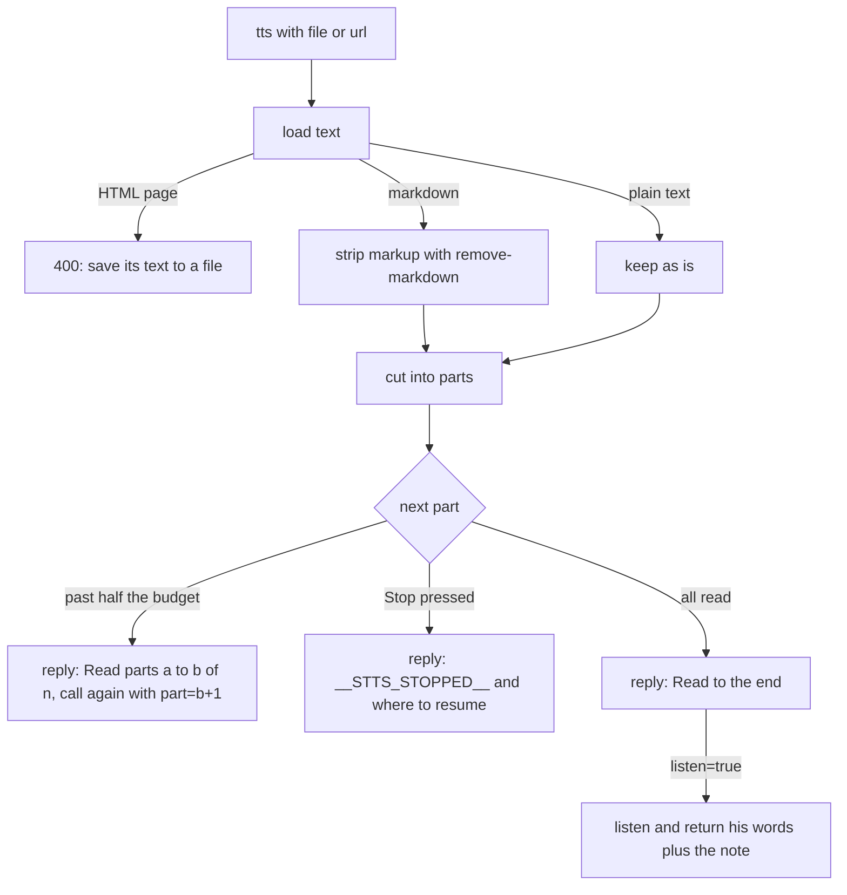

# File read-aloud in parts

## What it does

Lets an agent read out an existing file or web text (a story, a chapter, notes) by passing `file` or `url` to tts instead of copying the words. The daemon loads it, cuts it into parts of at most 1000 characters, speaks them in order, and says where to resume when it stops early.

## Why it exists

Pasting a long document into a tool call costs the agent output and time. Reading by reference is free for the agent, and parts let a long read survive the tool-call time limit.

## How it works

- `src/sentences.ts` cuts at sentence ends with the built-in `Intl.Segmenter`, packing sentences into parts of at most 1000 characters. A sentence longer than the limit is cut only at a clause mark (a comma, semicolon, colon or dash after at least 8 characters): the last one within the limit, else the first one past it; with none it stays whole up to 1000 characters, and only past that is it cut at a space, or hard-cut if it has none. Each clip is its own utterance, so a cut at a bare space put a pause and a falling tone mid-phrase (Mark 2026-10-12: "a threat ... detection service"). The callbot imports this file.
- Markdown (`.md`, `.markdown`, `.mdx`, or a markdown content type or URL) has its markup removed. Plain text is left alone. An HTML page is refused.
- `part=N` starts at part N; a part past the end is refused with the part count.
- No new part starts after half the budget (spec 003). The reply notes keep their exact text: `Read parts A to B of N. To go on, call tts again with the same file and part=B+1.`, `He stopped it during part P of N. To resume there, call tts with the same file and part=P.`, `Read to the end (part N of N).`
- A newer request supersedes the read between parts.
- A call's `rate` and `volume` hold for the window until it closes or the slider moves, never saved. The page reads them from each request (the machine's actions read refs, since they are bound at mount), and logs `page rate R for this window`. Before this the page ignored both and always used its slider. Covered by the e2e "a tts rate reaches the browser voice and holds for the window".
- Every judgement on his voice over the agent's speech is logged: `page voice over speech, clip N` at his first sound, `page final over speech: barge|short|echo, W words, Tms into the clip` per final, so a barge that did not cut the speech off shows why.
- Barge-in is the text path's: every part is an ordinary tts in the slot, so his words over a part cut it off at once and the call returns his turn, the `interrupted ... at part P sentence S` line and the unspoken rest of that part (Mark 2026-11-05). Covered by the daemon test "a spoken barge cuts a file read-aloud off" and the e2e "speaking over a file read cuts it off like a text tts".

## Quality bar

Register B19 (ISO/IEC 25010:2023). Baselines measured 2026-11-26 unless dated.

| Aspect | Metric, baseline and floor | Research and alternative | Gate |
| --- | --- | --- | --- |
| Functional suitability | File or url text cut into parts of at most 1000 characters and spoken in order, with a resume point: `sentences.test.ts` 16/16; floor 0 failing | sentence-boundary cutting; alternative: fixed-size cuts (broke words) | vitest in `npm run gate` (Trunk pre-push) |
| Performance efficiency and optimisation | A 5 MB file is cut inside the 30 s test limit (`sentences.test.ts` 2.9 s for all 16 cases) | streamed cutting | `sentences.test.ts` |
| Compatibility | Windows paths and urls both load | path cases in the test | `sentences.test.ts` |
| Interaction capability | Stopping early says where to resume | resume-point pattern from audiobook players | daemon tests |
| Reliability | Empty input and text with no sentence end handled without error | edge cases first (test catalog) | `sentences.test.ts` |
| Security | 0 secrets in repo; the daemon and Piper bind 127.0.0.1 only, nothing listens off the machine; floor 0 gitleaks findings | OWASP ASVS V14 config; alternative: LAN-reachable daemon (rejected: no auth needed when local only) | gitleaks in Trunk (`trunk check` in the gate) |
| Maintainability | `npm run maint` 2026-11-26: 0 dependency violations (53 modules), 0 jscpd clones, knip clean; spec has the five sections; floor all three clean | dependency-cruiser, knip, jscpd; markdownlint MD043 for sections | `npm run maint`, `markdownlint-cli2` in `npm run gate` (Trunk pre-push) |
| Flexibility and portability | Any text file or web text, no format limit beyond text | n/a: one input kind | n/a |
| Safety | Read-only: the file is read, never written | least privilege | code review in spec |
| Business outcome | n/a: Mark's personal voice tool, no business metric | n/a | n/a |
| Cost | USD 0: Chrome speech recognition and local Piper, no paid API; floor no paid call added | free platform APIs first (rule 1) | n/a: no paid dependency to cap (rule 97) |

## What it reads and writes

Reads the named local file, or fetches the URL with a 10 second limit. Writes nothing.

## How to run, check and hand over

`test/unit/sentences.test.ts` covers empty input, a 5 MB file, text with no sentence end, the 1000 character boundary and Windows paths. The daemon tests cover parts, resume and stop. Run `npm test`.
