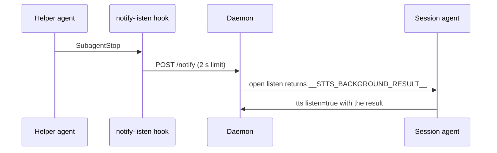

# Plugin shell and hooks

## What it does

Packages stts as the Claude Code plugin `stts` in the marketplace `stts-marketplace`: the `/stts` command that runs the voice loop, a skill with the same instructions, the MCP server entry, and a hook that interrupts a listen when a background helper or a background workflow finishes.

## Why it exists

The plugin is how an agent session gets voice with one install. The hook lets Mark hear a helper's result the moment it is ready instead of after his next sentence.

## How it works

- `.claude-plugin/plugin.json` and `marketplace.json` name the plugin and point at `github.com/markkennethbadilla/stts`. There is no version field; the commit is the version.
- `.mcp.json` registers `stts-mcp` as `node ${CLAUDE_PLUGIN_ROOT}/dist/mcp.js` (spec 008).
- `commands/stts.md` (and `commands/stts.toml` for agents that read TOML) and `skills/stts/SKILL.md` tell the agent the loop: call stt, act on each sentinel, answer every turn with tts and `listen=true`, speak before working, write for the ear.
- `hooks/hooks.json` runs `hooks/notify-listen.mjs` on every `SubagentStop` and on `PostToolUse` of the `Workflow` tool, with a 5 second limit.

The hook always exits 0, even when the daemon is down or slow. With no open listen, `/notify` does nothing; nothing is latched for a later listen. A tts with listen whose speech is still playing is never cut short: the background result is held on that call and returned the moment its speech ends and its listen opens (the page sends `listening`). It used to return mid-speech, so the agent sent its next tts over the old audio (Mark 2026-10-15).

The hook skips an agent that runs inside a Workflow (`agent_type` `workflow-subagent`, or a transcript under `subagents/workflows/`). The session gets a task-notification only when the whole workflow finishes, not per inner agent, so releasing the listen for each one made the loop spin on `__STTS_BACKGROUND_RESULT__` with nothing to relay (2026-10-09, seven releases in one workflow).

Claude Code fires no hook when a workflow itself finishes (checked in the 2.1.296 binary: `TaskCompleted` covers only agent-team task lists, and a workflow's end only queues the task-notification). So the hook catches the launch instead. On `PostToolUse` of `Workflow`, it takes the run id (`wf_...`) from the tool result and the session from `transcript_path`, and posts `/notify?watch=<project>/<session>/workflows/<run id>.json`. That file is the run's state; Claude Code writes its final `status` (`completed`, `failed` or `killed`) just before it queues the task-notification. The daemon polls the file every half second. A write that says `completed` or `failed` releases whatever listen is open one second later, so the notification is in place when the session reads the result. `killed` stops the watch without a release, because the session stopped the run itself. Only a write after the launch counts: a resumed run reuses its file, which still holds the old status (`wf_e0902567-376`, 2026-10-14). A watch that never sees an end is dropped after a day. A path that is not a `workflows/wf_*.json` file gets a 400. Before this, a workflow's end never interrupted the listen; the session heard about it only when Mark spoke or ended the listen (2026-10-14).

## What it reads and writes

The hook reads the `SubagentStop` or `PostToolUse` payload on stdin and `STTS_PORT`, and makes at most one local HTTP call. The daemon reads the watched workflow state file. Nothing is written.

## How to run, check and hand over

`test/unit/hook.test.ts` proves the hook exits 0 with the daemon down, that a workflow agent's stop does not reach `/notify` while a top-level agent's stop does, and that a `Workflow` launch posts the right state file to watch. `test/unit/daemon.test.ts` proves `/notify?watch` ignores the stale status a resumed run starts with and releases the listen once the file says `completed`. After an install, run `/stts` in Claude Code and check the window opens.
