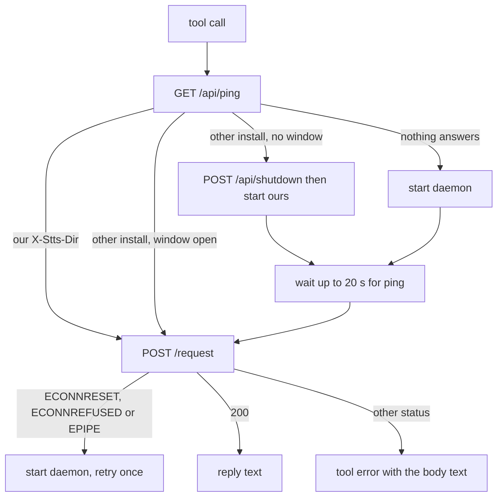

# MCP server and client

## What it does

Gives any agent two tools, `stt` (listen and return what he said) and `tts` (speak, optionally then listen), over the standard Model Context Protocol on stdio. Behind them, a small client finds or starts the daemon and sends the request.

## Why it exists

MCP is how every agent calls tools. The official SDK handles the protocol, so no custom JSON-RPC code exists. The client hides daemon start-up and restarts so the agent just calls a tool.

## How it works

- `src/mcp.ts` registers `stt` and `tts` with the official `@modelcontextprotocol/sdk`. Input schemas and descriptions come straight from `src/protocol.ts` (spec 001), so the notes and sentinels in the descriptions cannot drift.
- `STTS_WHO=agent` marks every call as from a helper agent (its `close` is ignored); anything else means `session`.
- `src/client.ts`:

The daemon is started detached and hidden (`node dist/daemon.js`), and the client waits up to 20 seconds for it to answer a ping before failing with `stts daemon did not start`: a cold start after a long idle, redirected to the newest install (two node launches), took over 5 seconds and failed the call (2026-10-11 22:32 UTC). The client also watches the spawned process: if it exits non-zero while the client waits (syntax error, bad install), the client asks whatever answers on the port to shut down, spawns once more, and on a second early exit fails at once with `stts daemon exited at start with code N` (about 0.2 s, not 20 s). 2026-11-04: a merge conflict marker committed in `dist/daemon.js` made every call wait the full 20 s; dist is build output, so rebuild with `npx tsdown && npx vite build` and grep it for `<<<<<<<` before committing. The request waits the budget plus 5 seconds.

## Quality bar

Register B19 (ISO/IEC 25010:2023). Baselines measured 2026-11-26 unless dated.

| Aspect | Metric, baseline and floor | Research and alternative | Gate |
| --- | --- | --- | --- |
| Functional suitability | `stt` and `tts` schemas, notes and sentinels in descriptions: `mcp.test.ts` 4/4; retry and stale-install handover: `client.test.ts` 7/7; floor 0 failing | official MCP SDK over stdio; alternative: HTTP-only tools (not every CLI speaks it) | vitest in `npm run gate` (Trunk pre-push) |
| Performance efficiency and optimisation | Client waits 20 s for a starting daemon (was 5 s; a start took about 11 s) | measured start time (spec 013) | `client.test.ts` |
| Compatibility | Any MCP client on stdio, plus the gateway (spec 010) | Model Context Protocol | `mcp.test.ts` |
| Interaction capability | n/a: agent-facing tools, no human UI here | n/a | n/a |
| Reliability | A stale install hands over to the new daemon; a retry never doubles a request | idempotent retry | `client.test.ts` |
| Security | 0 secrets in repo; the daemon and Piper bind 127.0.0.1 only, nothing listens off the machine; floor 0 gitleaks findings | OWASP ASVS V14 config; alternative: LAN-reachable daemon (rejected: no auth needed when local only) | gitleaks in Trunk (`trunk check` in the gate) |
| Maintainability | `npm run maint` 2026-11-26: 0 dependency violations (53 modules), 0 jscpd clones, knip clean; spec has the five sections; floor all three clean | dependency-cruiser, knip, jscpd; markdownlint MD043 for sections | `npm run maint`, `markdownlint-cli2` in `npm run gate` (Trunk pre-push) |
| Flexibility and portability | Spare `STTS_PORT` for a live check without touching the running daemon | env config | live check in this spec |
| Safety | `POST /api/shutdown` only on 127.0.0.1 | local-only control | `daemon.test.ts` |
| Business outcome | n/a: Mark's personal voice tool, no business metric | n/a | n/a |
| Cost | USD 0: Chrome speech recognition and local Piper, no paid API; floor no paid call added | free platform APIs first (rule 1) | n/a: no paid dependency to cap (rule 97) |

## What it reads and writes

Reads `STTS_PORT`, `STTS_REQUEST_TIMEOUT_MS`, `STTS_WHO`. Talks HTTP to `127.0.0.1` only.

## How to run, check and hand over

`node dist/mcp.js` after `npm run build`. `test/unit/mcp.test.ts` checks the schemas and that every note and sentinel is in the descriptions; `client.test.ts` checks retry and the stale-install handover. A live check: connect with the SDK's stdio client on a spare `STTS_PORT`, call tts, then stt, then `POST /api/shutdown`.
