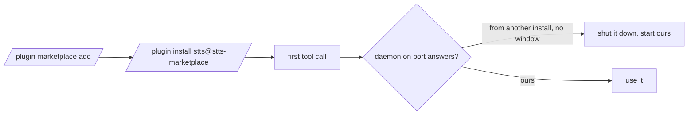

# Install and upgrade

## What it does

Covers how stts gets onto a machine, how it is built, and how a new version replaces a running old one without Mark doing anything.

**stts is a public repository** (`markkennethbadilla/stts`, featured on Mark's GitHub profile). Anyone can install the plugin, so every change must keep it working for a user who has none of our setup (no mkb-agentops, no `A:\models`, no `config.json`). See "Public repo rules" below.

## Why it exists

Strangers install it from GitHub; a change that only works on Mark's machines breaks them silently, and they cannot see our ops repos. An upgrade used to leave the old daemon serving with old code. The install-folder check retires it automatically, and keeping the data folder means his mic permission and settings survive.

## How it works

- Install: `/plugin marketplace add markkennethbadilla/stts`, then `/plugin install stts@stts-marketplace`.
- Upgrade: `/plugin update stts@stts-marketplace`. On the next call the client sees a different `X-Stts-Dir` and replaces the old daemon, unless a conversation is open, in which case the old one finishes first (spec 008).
- Build: `npm run build` runs tsdown and Vite. tsdown bundles `src/mcp.ts` and `src/daemon.ts` into two self-contained files, `dist/mcp.js` and `dist/daemon.js`, with every runtime dependency inlined (only Node builtins stay external, target Node 20), and copies the earcons to `dist/earcon/` and the icons and manifest to `dist/web/`. Vite builds the page into `dist/web/`.
- `dist/` is committed to git. `/plugin install` only copies the repository, with no `npm install` and no build, so the committed `dist/` is what runs. `node_modules/` stays ignored. Every change to `src/`, `web/` or `public/` is committed together with the rebuilt `dist/`; the push gate runs `npm run build` and then `git diff --exit-code -- dist`, so a stale `dist/` fails the build.
- Data stays in `%LOCALAPPDATA%\stts\`: the Chrome profile (mic grant and settings), Piper, and `daemon.log`. Back up `profile` before moving or deleting it.
- First start fetches what is missing: `scripts/install.mjs`, run by the daemon at start (`--auto`; exits at once when every part is there) or by hand (`node scripts/install.mjs`, `--check` lists what is missing). It creates the Python venv `<data>/piper/venv` (needs Python 3.10+ on PATH; `py -3` on Windows), pip-installs the pinned `piper-tts[http]` and `onnx-asr`, npm-installs `sherpa-onnx-node` into `<data>/asr`, and downloads the Piper voice into `<models>/piper`, the Parakeet v3 files into `<models>/parakeet/parakeet-tdt-0.6b-v3-int8` and `silero_vad.onnx` into `<data>/models` (about 760 MB the first time; about 18 minutes in a clean-machine test on 2026-11-14). Every pin, URL and SHA256 is in `install.json`; a file is kept only when its SHA256 matches. Lines go to `daemon.log` (`START install`, `OK install`, `FAIL install`); after a fetch the speech engine loads without a restart. Until then the page speaks with the browser voice and says the speech engine is not installed. `STTS_NO_INSTALL=1` turns it off (the tests set it).
- Models live in one models folder: env `STTS_MODELS_DIR`, else `modelsDir` in `<data>/config.json`, else `<data>/models`. Our install (mkb-agentops `setup-stts.ps1`) writes `config.json` with `A:\models`, the shared blessed store (mkb-winops spec 061), so no account keeps its own copy and the installer finds every model already there and downloads none.
- An install that still has the data folder under its upstream name is moved in place to `%LOCALAPPDATA%\stts` by mkb-agentops `setup-stts.ps1` (profile and settings kept, nothing downloaded again).
- Dependencies are pinned to exact versions; Renovate keeps them current (`package.json`, and the `install.json` packages through the custom managers in `renovate.json`).

**Public repo rules.**

Every change to stts, by any agent, is checked against these before it is pushed:

1. Works with no setup of ours: the defaults (data folder, `<data>/models`, the installer) must give a working voice window on a clean machine. Nothing in `src/`, `web/` or `scripts/` may need `A:\`, mkb-agentops, mkb-winops, a vault or any account of ours.
2. House-only behaviour is opt-in through a setting (env, `config.json`) that our setup writes, never a default in code. Our machines' extras live in mkb-agentops `setup-stts.ps1`.
3. User-facing text (README, errors, page messages, logs) tells a stranger what to do with stts alone (`node scripts/install.mjs`), never "run setup-stts.ps1".
4. A new part the daemon needs (a package, model or file) goes into `install.json` and `scripts/install.mjs` in the same commit, so first start still fetches it.
5. No secret, personal path, account name or private host in the repository; comments and specs that name our setup say it is ours.
6. Data a user already has (profile, settings, `config.json`) survives an upgrade; a moved folder is migrated in place.
7. Before the push: the unit tests, and for a change to install or paths, `node scripts/install.mjs --check` with `STTS_DATA_DIR` and `STTS_MODELS_DIR` pointed at an empty temp folder lists every part (nothing assumed present).

## What it reads and writes

Reads `install.json`, `config.json` and env `STTS_DATA_DIR`, `STTS_MODELS_DIR`, `STTS_PIPER_HOME`, `STTS_NO_INSTALL`. Writes the plugin folder, the data folder and the models folder above; downloads from PyPI, npm, Hugging Face (`rhasspy/piper-voices`, `istupakov/parakeet-tdt-0.6b-v3-onnx`) and the sherpa-onnx GitHub release.

## How to run, check and hand over

`npm ci`, then `npm run check`, then `npm run build`. `test/unit/build.test.ts` checks the build output exists. To prove the plugin runs as installed: `git archive main | tar -x` into an empty folder, and run `node dist/mcp.js` there with no `npm install`. After an update, call any tool and look for `daemon start pid` in `daemon.log`. A clean-machine check of the installer: `STTS_DATA_DIR=<empty temp> node scripts/install.mjs` (with `STTS_MODELS_DIR` at an existing models folder to skip the large downloads), then `--check` says `nothing missing`.
