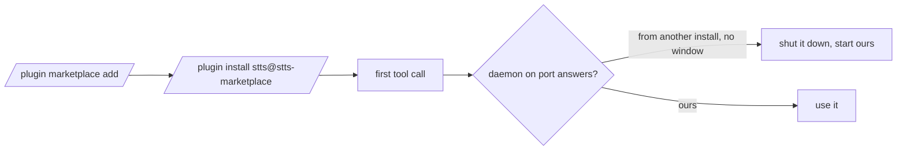

# Install and upgrade

## What it does

Covers how stts gets onto a machine, how it is built, and how a new version replaces a running old one without Mark doing anything.

**stts is a public repository** (`markkennethbadilla/stts`, featured on Mark's GitHub profile). Anyone can install the plugin, so every change must keep it working for a user who has none of our setup (no mkb-agentops, no `A:\models`, no `config.json`). See "Public repo rules" below.

## Why it exists

Strangers install it from GitHub; a change that only works on Mark's machines breaks them silently, and they cannot see our ops repos. An upgrade used to leave the old daemon serving with old code. The install-folder check retires it automatically, and keeping the data folder means his mic permission and settings survive.

## How it works

- Install: `/plugin marketplace add markkennethbadilla/stts`, then `/plugin install stts@stts-marketplace`.
- Upgrade: `/plugin update stts@stts-marketplace`. On the next call the client sees a different `X-Stts-Dir` and replaces the old daemon, unless a conversation is open, in which case the old one finishes first (spec 008).
- Build: `npm run build` runs tsdown and Vite. tsdown bundles `src/mcp.ts` and `src/daemon.ts` into two self-contained files, `dist/mcp.js` and `dist/daemon.js`, with every runtime dependency inlined (only Node builtins stay external, target Node 20), and copies the earcons to `dist/earcon/` and the icons and manifest to `dist/web/`. Vite builds the page into `dist/web/`.
- `dist/` is committed to git. `/plugin install` only copies the repository, with no `npm install` and no build, so the committed `dist/` is what runs. `node_modules/` stays ignored. Every change to `src/`, `web/` or `public/` is committed together with the rebuilt `dist/`; the push gate runs `npm run build` and then `git diff --exit-code -- dist`, so a stale `dist/` fails the build.
- Data stays in `%LOCALAPPDATA%\stts\`: the Chrome profile (mic grant and settings) and `daemon.log`. Back up `profile` before moving or deleting it.
- Nothing is fetched on first start: speech is Chrome's own (spec 014), so there is no model, Python venv, native addon or download, and the daemon runs the committed `dist/` as it is. A machine that ran the old local engine can delete its leftovers (spec 014, last section); mkb-agentops `setup-stts.ps1` does it on our machines.
- An install that still has the data folder under its upstream name is moved in place to `%LOCALAPPDATA%\stts` by mkb-agentops `setup-stts.ps1` (profile and settings kept, nothing downloaded again).
- Dependencies are pinned to exact versions; Renovate keeps them current (`package.json`).

**Public repo rules.**

Every change to stts, by any agent, is checked against these before it is pushed:

1. Works with no setup of ours: the defaults (data folder, Chrome's own speech) must give a working voice window on a clean machine. Nothing in `src/`, `web/` or `scripts/` may need `A:\`, mkb-agentops, mkb-winops, a vault or any account of ours.
2. House-only behaviour is opt-in through a setting (env, `config.json`) that our setup writes, never a default in code. Our machines' extras live in mkb-agentops `setup-stts.ps1`.
3. User-facing text (README, errors, page messages, logs) tells a stranger what to do with stts alone, never "run setup-stts.ps1".
4. A new part the daemon needs (a package, model or file) is bundled into `dist/` or fetched by the daemon itself in the same commit. No local model is added for listening (Mark 2026-11-25); the one local model is the Piper voice, installed only when the user runs `node scripts/install.mjs` (Mark 2026-11-26, spec 014).
5. No secret, personal path, account name or private host in the repository; comments and specs that name our setup say it is ours.
6. Data a user already has (profile, settings, `config.json`) survives an upgrade; a moved folder is migrated in place.
7. Before the push: the unit tests, and a start of the built `node dist/daemon.js` with `STTS_DATA_DIR` pointed at an empty temp folder that logs `daemon start` and nothing else (nothing assumed present).

## Quality bar

Register B19 (ISO/IEC 25010:2023). Baselines measured 2026-11-26 unless dated.

| Aspect | Metric, baseline and floor | Research and alternative | Gate |
| --- | --- | --- | --- |
| Functional suitability | Build output present: `build.test.ts` 1/1 (7.1 s); `dist` committed and equal to a fresh build (`git diff --exit-code -- dist`); floor 0 diff | commit `dist` so a plugin install needs no `npm install`; alternative: build on install (fails without node tooling) | `npm run gate` last step |
| Performance efficiency and optimisation | Upgrade reaches the open window in about 6 s (spec 013 check) | live hand-off | `live-update.test.ts` |
| Compatibility | Runs for a user with none of our setup (no mkb-agentops, no `A:\models`, no `config.json`): `git archive main` into an empty folder, `node dist/mcp.js` starts | public repo rules in this spec | manual archive check per release |
| Interaction capability | One plugin install gives voice; no restart on update | Claude Code plugin marketplace | spec 013 log lines |
| Reliability | The commit is the version (no version field to forget) | single source of version | `build.test.ts` |
| Security | 0 secrets in repo; the daemon and Piper bind 127.0.0.1 only, nothing listens off the machine; floor 0 gitleaks findings | OWASP ASVS V14 config; alternative: LAN-reachable daemon (rejected: no auth needed when local only) | gitleaks in Trunk (`trunk check` in the gate) |
| Maintainability | `npm run maint` 2026-11-26: 0 dependency violations (53 modules), 0 jscpd clones, knip clean; spec has the five sections; floor all three clean | dependency-cruiser, knip, jscpd; markdownlint MD043 for sections | `npm run maint`, `markdownlint-cli2` in `npm run gate` (Trunk pre-push) |
| Flexibility and portability | Plugin, gateway and stdio installs from the same `dist` | one artefact | spec 010 gateway check |
| Safety | An upgrade never drops an open listen (spec 013) | graceful hand-off | `live-update.test.ts` |
| Business outcome | n/a: Mark's personal voice tool, no business metric | n/a | n/a |
| Cost | USD 0: Chrome speech recognition and local Piper, no paid API; floor no paid call added | free platform APIs first (rule 1) | n/a: no paid dependency to cap (rule 97) |

## What it reads and writes

Reads `config.json` and env `STTS_DATA_DIR`, `STTS_PORT`. Writes the plugin folder and the data folder above. Downloads nothing.

## How to run, check and hand over

`npm ci`, then `npm run check`, then `npm run build`. `test/unit/build.test.ts` checks the build output exists. To prove the plugin runs as installed: `git archive main | tar -x` into an empty folder, and run `node dist/mcp.js` there with no `npm install`. After an update, call any tool and look for `daemon start pid` in `daemon.log`.
