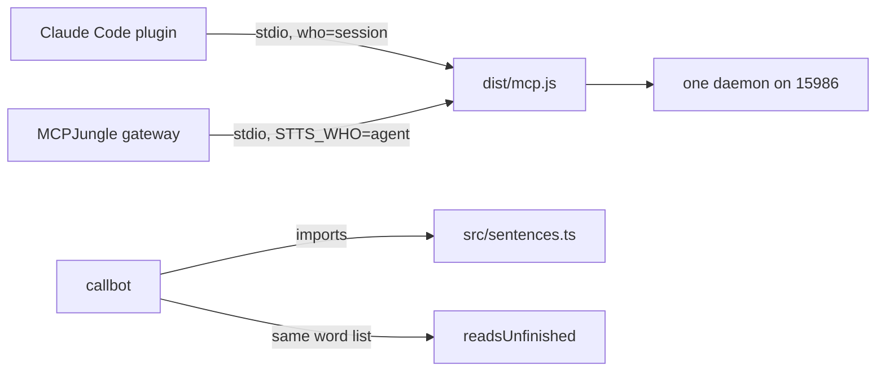

# Gateway and callbot sharing

## What it does

The same `dist/mcp.js` also runs behind the MCPJungle gateway, so every agent on the machine gets the tools as `stts_stt` and `stts_tts`. The callbot (the Google Meet voice bot) shares the sentence cutter and the unfinished-speech rule with stts.

## Why it exists

stts and the callbot are one voice product (house rule 67). Sharing code means a voice change lands in both and they behave the same.

## How it works

- The gateway entry lives in mkb-agentops and points at `dist/mcp.js` with `STTS_WHO=agent`, so a helper agent cannot close Mark's window. One exception, the one-off notice (Mark 2026-11-05): a tts with close and no listen, sent while no voice window is open (or into a window only notices have used), is marked `notice` by the daemon, speaks with the mic off and closes, from any caller. A window a listen or a plain tts has used is a conversation window and is never closed this way.
- Both paths share one daemon, so only one conversation is ever live.
- The callbot imports `src/sentences.ts`. Its `turn.mjs` keeps the same `readsUnfinished` word list; a parity test checks they match.
- Mic mute (spec 005) is stts only: muting drops every word heard or held, and only speech after unmute counts. The callbot has no mute; Mark mutes in the meeting, so it never receives his stream. Recorded in the callbot's spec 004 parity table.
- The barge-in toggle (spec 006) is stts only: in a meeting her voice is a separate participant and never reaches his stream, so the callbot has nothing to mute. Recorded in the callbot's spec 004 parity table.
- Idle end (spec 005) is stts only: a meeting has long quiet stretches by design, so the callbot never leaves on silence; it leaves when the meeting ends or Mark tells it to. Recorded in the callbot's spec 004 parity table.

## Quality bar

Register B19 (ISO/IEC 25010:2023). Baselines measured 2026-11-26 unless dated.

| Aspect | Metric, baseline and floor | Research and alternative | Gate |
| --- | --- | --- | --- |
| Functional suitability | `stts_stt` and `stts_tts` work through MCPJungle; sentence cutter and unfinished-word rule shared with the callbot; floor parity test green in both repos | one shared rule set; alternative: two copies (drifted) | parity test in each repo's gate |
| Performance efficiency and optimisation | Gateway calls return inside 280 s (budget 240 s, spec 003) | house rule 68 | `daemon.test.ts` budget case |
| Compatibility | Codex, Grok and Claude reach the same tools through the gateway | MCP gateway | a `stts_tts` call after a gateway change |
| Interaction capability | n/a: agent-facing | n/a | n/a |
| Reliability | A gateway voice loop takes a barge as its turn (2026-11-16 fix) | live log check | `daemon.test.ts` |
| Security | 0 secrets in repo; the daemon and Piper bind 127.0.0.1 only, nothing listens off the machine; floor 0 gitleaks findings | OWASP ASVS V14 config; alternative: LAN-reachable daemon (rejected: no auth needed when local only) | gitleaks in Trunk (`trunk check` in the gate) |
| Maintainability | `npm run maint` 2026-11-26: 0 dependency violations (53 modules), 0 jscpd clones, knip clean; spec has the five sections; floor all three clean | dependency-cruiser, knip, jscpd; markdownlint MD043 for sections | `npm run maint`, `markdownlint-cli2` in `npm run gate` (Trunk pre-push) |
| Flexibility and portability | New agent CLIs get voice by joining the gateway, no stts change | gateway pattern | n/a: no per-CLI code |
| Safety | n/a: same daemon rules as spec 003 | n/a | n/a |
| Business outcome | n/a: Mark's personal voice tool, no business metric | n/a | n/a |
| Cost | USD 0: Chrome speech recognition and local Piper, no paid API; floor no paid call added | free platform APIs first (rule 1) | n/a: no paid dependency to cap (rule 97) |

## What it reads and writes

Nothing beyond the MCP server (spec 008).

## How to run, check and hand over

A change to sentences or the word list is made here and in the callbot in the same session, and the parity test runs in both. After a gateway change, call `stts_tts` through the gateway and read `daemon.log`.
