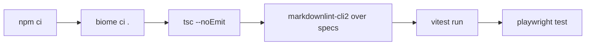

# Tests and CI

## What it does

Lists the checks that must pass before a change lands, and how to run them.

## Why it exists

Two bugs on 2026-10-05 (an undefined name that crashed the page, and mute being undone by a restart) reached Mark because nothing checked them. Each now has a test.

## How it works

- **Style and types:** Biome for lint and format; TypeScript with `@tsconfig/strictest`, no `any` and no suppressions.
- **Specs:** markdownlint-cli2 with `.markdownlint-cli2.jsonc`; rule MD043 makes every `specs/*/spec.md` have exactly the five sections in order.
- **Unit tests (vitest, `test/unit/`):** protocol and fixtures, turns, sentences, daemon through `app.request()`, client, MCP, hook, page machine, page log lines, build output, and the client-to-daemon integration.
- **Live check:** build, start the MCP server on a spare `STTS_PORT` with the SDK stdio client, call tts and stt, read `daemon.log`, then shut down.

- **End-to-end (Playwright, `test/e2e/`, `playwright.config.ts`):** builds, starts the daemon on `STTS_TEST_PORT` (default 15990) with its own data dir under `test-results/` and `STTS_NO_WINDOW=1` (it never launches a real window: one reopened by the self-heal took the page link from the test pages), and drives the page in headless Chromium with a fake speech recogniser, fake media, `page.clock` and a fake browser voice (`__tts` in `test/e2e/fixtures.ts`: it records every utterance and rate, holds the ones after the first N until released, and counts pause and resume). Page errors fail the run. Cases (`test/e2e/voice.spec.ts`, then `zz-regressions.spec.ts`, which runs last): the narrow-width Send button under the box, Dark Reader lock and theme, no chime on an automatic restart, a fragment of the spoken sentence treated as echo, a new tts mid-speech cutting the old one off, his voice pausing the speech at once and an echo final resuming it, End reaches the open listen once, leading words across a growing session, a listen produces a turn, pause survives 3 listens and the watchdog, an untrusted End click is ignored, `/notify` produces a background result, a file is read in parts and resumed.
- **Push gate (Trunk, `.trunk/trunk.yaml`), no GitHub Actions (removed 2026-10-23 on Mark's order):** `trunk git-hooks sync` installs the hooks. The commit hook runs gitleaks and git-diff-check on staged files. The push hook runs `npm run gate`: `trunk check --ci --all`, biome, tsc, spec lint, vitest, build, the Playwright smoke set (`npm run e2e:smoke`, the tests tagged `@smoke`), then `git diff --exit-code -- dist`, inside the 60 s test budget. The committed `dist/` is built in a checkout with its own `node_modules`: in a worktree whose `node_modules` is a link to the main checkout, the bundles carry other source paths (`../stts/node_modules/...`), so the gate's `dist` check fails; merge to the main checkout, build there and commit that `dist/`. The full browser suite (`npm test`, about 1.5 minutes) runs by hand before a release or after a change to the page or daemon (decided 2026-11-08: the full suite in the gate took 1.5 to 7 minutes). Both are custom actions with `--ci`, because Trunk's stock hook actions only warn when no terminal is attached. A failure refuses the push.

## Quality bar

Register B19 (ISO/IEC 25010:2023). Baselines measured 2026-11-26 unless dated.

| Aspect | Metric, baseline and floor | Research and alternative | Gate |
| --- | --- | --- | --- |
| Functional suitability | Unit 204/204 in about 34 s wall (2026-11-26), e2e 31/31 (2026-11-25); floor 0 failing before a push | local pre-push gate; alternative: hosted CI (sat red on main for six commits, 2026-10-06 to 07) | `npm run gate` (Trunk pre-push) |
| Performance efficiency and optimisation | Cold full run about 5.5 min (2026-10-23), Playwright about 3.5; push gate runs only the smoke e2e; budget only goes down | gate time budgets (mkb-agentops `gate-budgets.json`) | gate budget check |
| Compatibility | Windows 11 with Node and Chromium; `testTimeout` 30 s for spawn-heavy hook tests (node start about 1.5 s here) | vitest config | `vitest.config.ts` |
| Interaction capability | n/a: developer checks, no user UI | n/a | n/a |
| Reliability | Fakes for recogniser and speech (`__sttsRecognition`, `__tts`) make e2e deterministic | test doubles at the platform edge | e2e fixtures |
| Security | 0 secrets in repo; the daemon and Piper bind 127.0.0.1 only, nothing listens off the machine; floor 0 gitleaks findings | OWASP ASVS V14 config; alternative: LAN-reachable daemon (rejected: no auth needed when local only) | gitleaks in Trunk (`trunk check` in the gate) |
| Maintainability | `npm run maint` 2026-11-26: 0 dependency violations (53 modules), 0 jscpd clones, knip clean; spec has the five sections; floor all three clean | dependency-cruiser, knip, jscpd; markdownlint MD043 for sections | `npm run maint`, `markdownlint-cli2` in `npm run gate` (Trunk pre-push) |
| Flexibility and portability | `npm run check` (fast), `npm test` (full), `npm run e2e` (browser) split by need | tiered test runs | package scripts |
| Safety | Tests run on a spare port and fake audio; the live daemon is never touched | isolate tests from the running system | `daemon.test.ts` uses `app.request()` |
| Business outcome | n/a: Mark's personal voice tool, no business metric | n/a | n/a |
| Cost | USD 0: Chrome speech recognition and local Piper, no paid API; floor no paid call added | free platform APIs first (rule 1) | n/a: no paid dependency to cap (rule 97) |

## What it reads and writes

Tests use their own ports and fakes; they do not touch the live daemon on 15986.

## How to run, check and hand over

`npm run check` runs biome, tsc, the spec lint and the unit tests; `npm test` runs the spec lint, the unit tests, the build and the Playwright tests, and is the check before every push: the old CI ran the browser suite but sat red on main for six commits (2026-10-06 to 07) because nobody ran it before pushing. `npm run e2e` runs the Playwright tests alone.

**Gate time budget.** Cold run on Mark's PC 2026-10-23: about 5.5 minutes, of which Playwright is about 3.5. Budgets only go down. Node takes about 1.5 s to start on this PC, so `vitest.config.ts` sets `testTimeout: 30_000` for the spawn-heavy hook tests.
