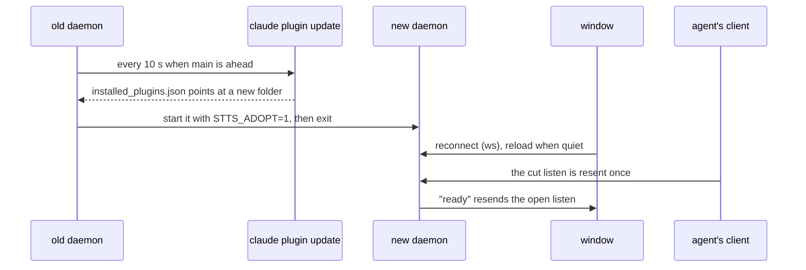

# Live update

## What it does

A new stts version reaches the open voice window by itself, between turns, with no restart of Claude Code, the window or the conversation. The agent's open listen carries on, and words already heard are kept.

## Why it exists

Every fix used to need Mark to close the window and restart the session, in the middle of a call. Mark (2026-10-06): no manual restart after each fix; changes apply in real time.

## How it works

- Every 10 s (`STTS_LIVE_UPDATE_MS`) the daemon reads the tip of `main` with `git ls-remote` (`STTS_REPO`; no API rate limit) and compares it with the installed plugin's cache folder, which is named after its commit. When main is ahead it runs Claude Code's own updater at once, `claude plugin marketplace update stts-marketplace` then `claude plugin update stts@stts-marketplace`, whatever the window is doing, and hands off at the first safe moment below (Mark 2026-10-12: "apply it immediately on finish ... always"). Before, the pull itself waited for a listen and ran once a minute, so a push reached the window a minute or more late. Offline, or an install not named after a commit (a dev run), it only checks for an already installed newer build.
- If `~/.claude/plugins/installed_plugins.json` (or `STTS_INSTALLS`) now points the `stts@` entry at another folder whose `dist/daemon.js` exists, the daemon logs `live update: handing off to DIR`, starts that `daemon.js` with `STTS_ADOPT=1` and exits. Chrome stays open.
- The old daemon stops taking connections, starts the new one, waits until it answers, moves the window to it, then forwards the open listen to it and passes the reply back on the connection the agent is already waiting on, so the agent never sees a dropped call (exiting first let the agent's client start its own older daemon, which won the port and handed off again every minute). It hands off only while a listen is open (a plain stt, or a tts with listen once the page reports `listening`, its speech done), so the agent makes no new call meanwhile, and the listen is forwarded as a plain stt; or when it is idle, with no call open and no window, so there is nothing to forward (a closed window held a new build back until the next session's first listen, 2026-11-15). The old daemon gives the call up before it closes its page (`giveUpSlot`), so the window self-heal (spec 003) never runs in it: holding the call, it relaunched Chrome every few seconds until the forwarded listen ended, a new window each time (live 2026-10-10 01:13 UTC).
- **The newest daemon keeps the port.** It does not exit when the window closes, when the page does not come back after a hand-off, or on End (End is remembered on disk instead). Exiting let an agent session's older client start its own, older daemon, and the window came back on an old build (2026-10-06 10:04).
- **Every daemon start** checks the installed plugin (a file read, no update) and, if it is a different and newer build, starts that one instead and exits (log `daemon start redirected to the newest install DIR`). An agent session keeps the MCP client it began with, and that client started its own, older daemon, so a new voice window showed old layout and behaviour until the next live update (Mark, 2026-10-06 09:23). The start never runs the plugin update before it opens its port: that took about 11 s and the client, which then waited 5 s (now 20 s, spec 008), failed the call with `stts daemon did not start` (2026-10-10 23:46 UTC). A build published after the start arrives through the minute's live update. A hand-off or redirect never goes to an older build (log `live update: refused a downgrade to DIR`). Newer means the later of `daemon.js` and `web/index.html` modification times: the plugin cache keeps the clone's file times, so a page-only change left `daemon.js` untouched and the daemon answered `up to date` forever (2026-11-15, the rate fix).
- The adopted daemon waits up to 10 s for the port, does not open a second window while the old one reconnects (8 s grace), and exits like a closed window if the page does not come back within 15 to 20 s.
- The page reconnects its socket on close. When the daemon folder (`X-Stts-Dir`) changed, it logs `live update: reloading for the new version` and reloads once no speech is playing and no words are held. A listen resent after a reconnect keeps the words already heard.
- The installed daemon sends `X-Stts-Latest: 1` and refuses `/api/shutdown` (409), so a session still running an older MCP client uses it instead of retiring it. Newer clients treat `X-Stts-Latest` as their own daemon.

To force it now instead of waiting up to 10 s: `curl -s -X POST --max-time 150 http://127.0.0.1:15986/api/update`. It runs the same update, answers `up to date` or `updating to DIR`, then hands off at the first safe moment (checked every second for up to 5 minutes).

## Quality bar

Register B19 (ISO/IEC 25010:2023). Baselines measured 2026-11-26 unless dated.

| Aspect | Metric, baseline and floor | Research and alternative | Gate |
| --- | --- | --- | --- |
| Functional suitability | A new version reaches the open window between turns with no restart: hand-off decision `live-update.test.ts` 6/6; one-off check 2026-10-06 hand-off in 6 s with the listen kept; floor 0 failing | daemon hand-off; alternative: restart Claude Code (lost the conversation) | vitest in `npm run gate` (Trunk pre-push) |
| Performance efficiency and optimisation | Checks `main` every 10 s (`STTS_LIVE_UPDATE_MS`); forced update hands off at the first safe moment, checked every second up to 5 min | polling a local tip, no network push | `live-update.test.ts` |
| Compatibility | Old and new daemons share the port protocol (spec 001) | versioned contract fixture | `protocol.test.ts` |
| Interaction capability | Words already heard are kept across the hand-off | no lost input | `live-update.test.ts` |
| Reliability | The adopted daemon waits 10 s for the port, 8 s reconnect grace, exits like a closed window if no page in 15 to 20 s | grace windows from the 2026-10 logs | `live-update.test.ts` |
| Security | 0 secrets in repo; the daemon and Piper bind 127.0.0.1 only, nothing listens off the machine; floor 0 gitleaks findings | OWASP ASVS V14 config; alternative: LAN-reachable daemon (rejected: no auth needed when local only) | gitleaks in Trunk (`trunk check` in the gate) |
| Maintainability | `npm run maint` 2026-11-26: 0 dependency violations (53 modules), 0 jscpd clones, knip clean; spec has the five sections; floor all three clean | dependency-cruiser, knip, jscpd; markdownlint MD043 for sections | `npm run maint`, `markdownlint-cli2` in `npm run gate` (Trunk pre-push) |
| Flexibility and portability | `STTS_LIVE_UPDATE_MS` sets the interval | env config | n/a: default used |
| Safety | Never hands off mid-speech or mid-turn | safe-point hand-off | `live-update.test.ts` |
| Business outcome | n/a: Mark's personal voice tool, no business metric | n/a | n/a |
| Cost | USD 0: Chrome speech recognition and local Piper, no paid API; floor no paid call added | free platform APIs first (rule 1) | n/a: no paid dependency to cap (rule 97) |

## What it reads and writes

Reads `installed_plugins.json`. Runs the `claude` CLI, which writes the plugin cache. Writes `daemon.log` lines (spec 012). Environment: `STTS_LIVE_UPDATE` (`0` off, used by the e2e tests; `check` skips the CLI), `STTS_LIVE_UPDATE_MS`, `STTS_INSTALLS`, `STTS_ADOPT` (set by the hand-off only).

## How to run, check and hand over

Nothing to run: it starts with the daemon. Check with `daemon.log`: a `live update: handing off` line, then `daemon start` from the new folder. `test/unit/live-update.test.ts` covers the hand-off decision. A one-off check (2026-10-06) ran daemon A with a window and an open listen, pointed the install file at B: hand-off in 6 s, the page reloaded, and the listen returned the turn spoken after it. The one restart still needed is the first one onto a version that has this feature. The agent's own MCP client is not replaced live: it is a thin HTTP client, and the daemon holds the behaviour.
